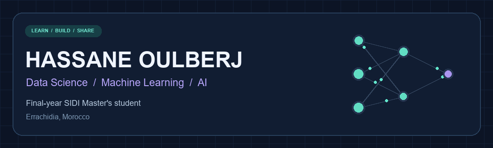

  

  <strong>Exploring new technologies. Learning from data. Building practical AI solutions.</strong>

  
  
  

  <a href="#about-me">About</a> · <a href="#toolbox">Toolbox</a> · <a href="#selected-projects">Projects</a> · <a href="#learning-direction">Learning</a>

## About me

I'm **Hassane Oulberj**, a **Data Science, Machine Learning & AI student** based in **Errachidia, Morocco**.

I'm in the final year of the **Master's in Systèmes d’Information Décisionnels et Imagerie (SIDI)** at the **Faculty of Sciences and Techniques of Errachidia, Moulay Ismail University**.

I'm interested in emerging technologies and in developing practical solutions with artificial intelligence. My academic projects connect data analysis, machine learning, image processing, cybersecurity and application development.

> My goal: turn what I learn into useful, understandable and reproducible projects.

## Toolbox

Technologies used across my academic projects and learning journey.

**Programming & databases**

**Data science & machine learning**

**Image processing & applications**

## Selected projects

| Project | What I explore | Technologies |
| :--- | :--- | :--- |
| [PFE — Evaluation Grid](https://github.com/hassaneoulberj-Dev/pfe-grille-evaluation) | An academic evaluation workflow with a desktop interface and database | Python · MySQL |
| [Transport Plus](https://github.com/hassaneoulberj-Dev/transport-plus-java) | Trip management, reservations and client/admin interfaces | Java Swing · MySQL |
| [IoMT ECC Security](https://github.com/hassaneoulberj-Dev/iomt-ecc-security) | An academic prototype exploring encryption for Internet of Medical Things scenarios | Python · ECC · AES-GCM |

<b>🔬 More from my project lab — click to expand</b>

### Hybrid intrusion detection

Experiments on the UNSW-NB15 dataset combining feature extraction and classification. I explore LSTM-based pipelines, MLP with tree ensembles, and PCA with Random Forest, with exported metrics and comparison plots.

### Image Contrast Lab

A Streamlit application comparing histogram equalization, CLAHE, gamma correction and contrast stretching. It includes image comparisons, histograms and downloadable results.

These are academic experiments. Image similarity metrics do not establish clinical usefulness, and cybersecurity benchmark results do not establish production readiness.

## Learning direction

<b>🧠 Data science & AI</b>

- Building reproducible data preparation and model evaluation workflows.
- Comparing models beyond accuracy, using precision, recall and F1-score.
- Understanding how feature extraction affects classification.

<b>👁️ Imaging & intelligent applications</b>

- Exploring image enhancement and quantitative comparison.
- Turning experiments into applications that people can try.
- Connecting Python and Java interfaces to structured data.

---

  Interested in data, AI or an academic collaboration? 
  <a href="mailto:hassane.oulberj@gmail.com">hassane.oulberj@gmail.com</a> ·
  <a href="https://www.linkedin.com/in/hassane-oulberj-2b0042322/">LinkedIn</a>

